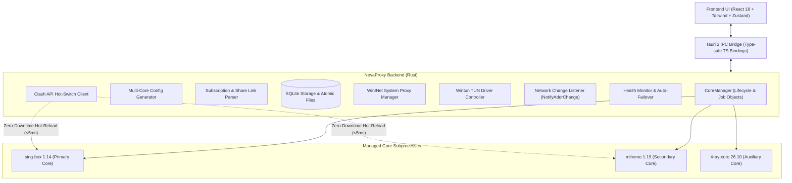

# NovaProxy 🚀

<div align="center">

**Next-Generation Cross-Platform Multi-Core VPN & Proxy Orchestrator**  
下一代全平台多内核 VPN / 代理客户端（Windows · macOS · Linux · Android）

[](releases)
[](https://www.rust-lang.org/)
[](https://tauri.app/)
[](https://react.dev/)
[](https://tailwindcss.com/)
[](LICENSE)
[](#)

[English](#english) | [简体中文](#简体中文)

</div>

---

<a name="english"></a>
## 🌐 English

### Overview

**NovaProxy** is a cross-platform multi-core proxy and VPN orchestrator built with **Tauri 2**, **Rust**, **Kotlin** (Android `VpnService`), and **React 18**. It orchestrates three industry-standard core binaries—**sing-box** (primary engine), **mihomo** (Clash.Meta), and **Xray-core**—across **Windows**, **macOS**, **Linux**, and **Android**, providing seamless routing, zero-downtime switching, persistent diagnostics/telemetry, and full protocol coverage across 17 modern proxy protocols.

### Key Features

- **4-Platform Compatibility (Windows · macOS · Linux · Android)**:
  - **Windows**: Registry + WinINet (`InternetSetOptionW`) system proxy with baseline recovery, Job Object child tracking (`KILL_ON_JOB_CLOSE`), Wintun TUN, `NotifyAddrChange` listener, and UAC elevation.
  - **macOS**: `networksetup` system proxy, LaunchAgents autostart, `osascript` admin prompts, `utun` support, and Apple Silicon (`arm64`) + Intel (`x64`) builds.
  - **Linux**: GNOME/KDE (`gsettings` / `kwriteconfig`) proxy control, XDG autostart & `.desktop` deep links, `pkexec` elevation, `/dev/net/tun` support, and `.deb` / `.AppImage` bundles.
  - **Android**: Native `NovaProxyVpnService` + `hev-socks5-tunnel` JNI forwarding (`arm64-v8a` & `x86_64`), W^X-compliant `nativeLibraryDir` core loading, and responsive mobile bottom navigation.
- **17 Proxy Protocols Supported**:
  - VLESS (XTLS / Reality / Vision), VMess, Trojan, Shadowsocks, ShadowsocksR
  - Hysteria, Hysteria 2 (port hopping), TUIC v5, WireGuard
  - ShadowTLS v3, NaiveProxy, Snell v4, Mieru, AnyTLS, SSH Tunnel, SOCKS5, HTTP
- **Multi-Core Orchestration & Relay**:
  - Automatically routes protocols to their optimal engine (e.g., sing-box for Reality/WireGuard/TUN, Xray for mKCP/XHTTP, mihomo for SSR/Snell/Mieru).
  - Multi-tier local relay support (e.g. Xray upstream SOCKS relay chained into sing-box routing) with automatic port conflict fallback.
- **Zero-Downtime Hot-Switching & Real Availability Probes**:
  - Dynamic active node switching via local Clash REST API (`PUT /proxies/{group}`) in **< 5ms** without tearing down active TCP connections.
  - Supports both concurrent TCP ping and real end-to-end SOCKS5 URL delay probing (compatible with UDP/QUIC protocols like Hysteria 2, TUIC, and WireGuard).
- **Persistent Rolling Logs, Telemetry & Optimization Insights**:
  - Full-pipeline persistence (`novaproxy.log` + structured `events.jsonl` with 4 MiB rotation and credential sanitization) capturing Rust `tracing`, core stdout/stderr, and frontend runtime errors.
  - Startup phase breakdown timings, protocol latency/timeout telemetry, automated optimization insights, and one-click sanitized `.zip` diagnostic bundle export.
- **Self-Healing Supervisor & Atomic Disaster Recovery**:
  - Process group / Job Object isolation prevents orphan core processes; exponential backoff recovery (`[1s, 2s, 4s]`, max 3 retries in 60s) and cooldown-protected active health failover.
  - UUID staging files + fsync + atomic rename, SQLite `PRAGMA integrity_check` + `VACUUM INTO` hot backups.
- **Deep Link & Multi-Format Subscription Engine**:
  - One-click import via `novaproxy://install-config?url=...` and `clash://install-config?url=...`.
  - Parses Base64, Clash YAML (with strategy groups), sing-box JSON, SIP008, and WireGuard INI with fingerprint deduplication.

### Architecture



---

<a name="简体中文"></a>
## 🇨🇳 简体中文

### 项目简介

**NovaProxy** 是一款跨平台全兼容（**Windows / macOS / Linux / Android**）的下一代高可用多内核代理与 VPN 客户端，基于 **Tauri 2**、**Rust**、**Kotlin**（Android `VpnService`）和 **React 18** 构建。通过协同调度 **sing-box**（主控引擎）、**mihomo**（Clash.Meta）与 **Xray-core** 三大业界标杆内核，支持全部 17 种现代代理协议，并内置全链路滚动持久化日志与性能遥测优化分析系统。

### 核心特性

- **四端全兼容架构（Windows · macOS · Linux · Android）**：
  - **Windows**：注册表 + WinINet 广播与基线还原、Job Object 进程托管、Wintun TUN、`NotifyAddrChange` 监听与 UAC 提权。
  - **macOS**：`networksetup` 系统代理、LaunchAgents 自启、`osascript` 提权、`utun` 支持，支持 Apple Silicon (`arm64`) 与 Intel (`x64`)。
  - **Linux**：GNOME/KDE 系统代理、XDG 自启与桌面快捷链接、`pkexec` 提权、`/dev/net/tun` 支持，打包 `.deb` 与 `.AppImage`。
  - **Android**：原生 `NovaProxyVpnService` + `hev-socks5-tunnel` JNI 隧道转发（`arm64-v8a` & `x86_64`）、符合 W^X 规范的 `nativeLibraryDir` 内核加载与移动端响应式底栏。
- **17 种主流与前沿协议全覆盖**：
  - 经典与通用：VMess, VLESS (Reality / Vision), Trojan, Shadowsocks, ShadowsocksR, SOCKS5, HTTP
  - UDP 性能与下一代：Hysteria, Hysteria 2 (支持端口跳跃), TUIC v5, WireGuard
  - 混淆与防封锁：ShadowTLS v3, NaiveProxy, Snell v4, Mieru, AnyTLS, SSH Tunnel
- **多内核智能选核与中继协同**：
  - 协议能力矩阵自动推荐最优内核（sing-box 负责 Reality/WireGuard/TUN，Xray 负责 mKCP/XHTTP，mihomo 负责 SSR/Snell/Mieru/复杂策略组）。
  - 支持本地双层级联中继（如 Xray 作为前置 SOCKS5 桥接接入 sing-box 主分流引擎），端口冲突自动顺延。
- **零停机热切换与真实可用性测速**：
  - 节点切换优先经由本地 Clash REST API（`PUT /proxies/{group}`）**< 5ms** 内存换线，不断开已有长连接。
  - 同时支持并发 TCP Ping 与真实代理 SOCKS5 URL 端到端 204 测速（完整覆盖 Hysteria 2 / TUIC / WireGuard 等 UDP 协议）。
- **全链路持久化日志与性能遥测优化台**：
  - 全量收集内核 stdout/stderr、Rust `tracing` 事件与前端运行时异常，脱敏凭据后写入 4 MiB 轮转日志 `novaproxy.log` 与结构化 `events.jsonl`。
  - 内置启动拆解耗时、协议测速成功率统计、故障转移告警与中英双语自动优化建议，并支持一键导出脱敏 `.zip` 诊断压缩包。
- **崩溃自愈、健康故障转移与原子容灾**：
  - 60 秒滑动窗口指数退避自愈守护 + 冷却防抖动的健康自动 Failover。
  - 临时 UUID 文件 + `sync_all` + 原子重命名，配合 SQLite `PRAGMA integrity_check` 与 `VACUUM INTO` 热备。
- **深层链接与多格式订阅引擎**：
  - 支持 `novaproxy://install-config?url=...` 与 `clash://install-config?url=...` 单实例唤醒导入。
  - 智能解析 Base64、Clash YAML（含智能策略组）、sing-box JSON、SIP008、WireGuard INI 并按指纹增量同步去重。

---

## 🛠️ 构建与开发指南 (Build & Development)

### 系统要求
- **桌面支持**：Windows 10/11 (x64)、macOS 12+ (arm64/x64)、Linux (Ubuntu 22.04+ / Debian / Arch 等 x64)
- **移动支持**：Android 7.0+ (API 24+, `arm64-v8a` / `x86_64`)
- **Node.js**：>= 20.0 (推荐 Node 22+) & **pnpm** >= 9.0
- **Rust**：>= 1.80（Android 交叉构建需额外添加 `aarch64-linux-android` 与 `x86_64-linux-android` target 以及 Android SDK/NDK 28）

### 1. 克隆项目与安装依赖
```bash
git clone https://github.com/luo-5/NovaProxy.git
cd NovaProxy
pnpm install
```

### 2. 下载与校验内核二进制 (sing-box, mihomo, Xray)
仓库不提交预编译内核二进制，请先运行内置脚本拉取官方 Release 并校验：
```powershell
# Windows PowerShell:
./scripts/fetch-cores.ps1
```
```bash
# macOS / Linux / Android JNI Cores:
chmod +x scripts/fetch-cores.sh
./scripts/fetch-cores.sh
```

### 3. 本地开发与调试
```bash
# 启动桌面端热重载开发模式
pnpm tauri dev
```

### 4. 运行全套测试套件
```bash
# 运行前端 Lint、类型检查、Vitest 单元测试与构建
pnpm lint
pnpm exec tsc --noEmit
pnpm test
pnpm build

# 运行后端格式化、Clippy 与全部集成测试 (包含三内核静态校验与端到端测试)
cd src-tauri
cargo fmt --check
cargo clippy --all-targets -- -D warnings
cargo test -- --test-threads=4
```

### 5. 打包桌面端与 Android APK
```powershell
# Windows 构建 NSIS 安装包 (产物: src-tauri/target/release/bundle/nsis/NovaProxy_0.0.1_x64-setup.exe)
pnpm tauri build --bundles nsis

# Android 构建通用 APK (arm64-v8a + x86_64)
./scripts/build-android.ps1
```

---

## 📄 开源许可与第三方声明 (Licenses)

NovaProxy 源码基于 **MIT License** 开源。集成或调用的三方开源项目遵循其各自独立协议：

- **sing-box**：[GPL-3.0-or-later](https://github.com/SagerNet/sing-box/blob/main/LICENSE)
- **mihomo**：[GPL-3.0-or-later](https://github.com/MetaCubeX/mihomo/blob/Alpha/LICENSE)
- **Xray-core**：[MPL-2.0](https://github.com/XTLS/Xray-core/blob/main/LICENSE)
- **Wintun**：[MIT License](https://git.zx2c4.com/wintun/about/)
- **hev-socks5-tunnel**：[MIT License](https://github.com/heiher/hev-socks5-tunnel/blob/main/LICENSE)

详见 [`docs/THIRD_PARTY_LICENSES.md`](docs/THIRD_PARTY_LICENSES.md)。
