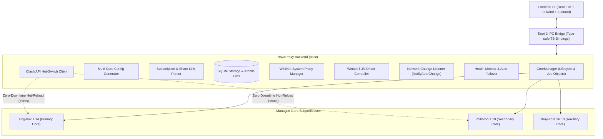

# NovaProxy 🚀

<div align="center">

**Next-Generation Multi-Core Windows VPN & Proxy Orchestrator**  
下一代多内核 Windows 桌面 VPN / 代理客户端

[](https://www.rust-lang.org/)
[](https://tauri.app/)
[](https://react.dev/)
[](https://tailwindcss.com/)
[](LICENSE)
[](https://microsoft.com)

[English](#english) | [简体中文](#简体中文)

</div>

---

<a name="english"></a>
## 🌐 English

### Overview

**NovaProxy** is an enterprise-grade Windows proxy orchestrator built with **Tauri 2**, **Rust**, and **React 18**. It orchestrates three industry-standard core binaries—**sing-box** (primary engine), **mihomo** (Clash.Meta), and **Xray-core**—providing seamless routing, zero-downtime switching, and full protocol coverage across 17 modern proxy protocols.

### Key Features

- **17 Proxy Protocols Supported**:
  - VLESS (XTLS / Reality / Vision), VMess, Trojan, Shadowsocks, ShadowsocksR
  - Hysteria, Hysteria 2, TUIC v5, WireGuard
  - ShadowTLS v3, NaiveProxy, Snell v4, Mieru, AnyTLS, SSH Tunnel, SOCKS5, HTTP
- **Multi-Core Orchestration & Capabilities**:
  - Automatically routes protocols to their optimal engine (e.g., sing-box for Reality/WireGuard/TUN, Xray for mKCP/XHTTP, mihomo for complex rule-providers).
  - Multi-tier local relay support (e.g. Xray upstream SOCKS relay chained into sing-box routing).
- **System Proxy & Zero Residual Rollback**:
  - Native Windows Registry + WinINet (`InternetSetOptionW` 39/37) proxy synchronization.
  - Automatically captures baseline system proxy settings on startup and **guarantees 100% clean restoration** on exit, ungraceful crash, or uninstallation—never leaves Windows without internet.
- **Wintun TUN Mode**:
  - Global virtual network adapter routing powered by Wintun.
  - Intercepts all TCP, UDP, and ICMP traffic for non-proxy-aware desktop apps and games with Fake-IP and DNS hijacking.
- **Zero-Downtime Hot-Switching**:
  - Dynamic active node switching via local Clash REST API (`PUT /proxies/{group}`) in **< 5ms** without tearing down active TCP connections or restarting the process.
- **Self-Healing Supervisor**:
  - Monitors child core processes with Windows Job Objects (`KILL_ON_JOB_CLOSE`).
  - Exponential backoff recovery (`[1s, 2s, 4s]`, max 3 attempts within 60s) preventing high-CPU restart loops.
- **Active Node Health Probe & Auto-Failover**:
  - Background probe monitors active node latency.
  - Automatically fails over to the fastest healthy alternative upon 2 consecutive failures.
- **Network Interface Awareness**:
  - Win32 `NotifyAddrChange` listener synchronizes proxy settings on WiFi switching, IP renewals, and sleep/wake events.
- **Atomic Configuration & Disaster Recovery**:
  - UUID staging files + fsync + atomic rename to prevent 0-byte configuration corruption.
  - SQLite `PRAGMA integrity_check` verification and `VACUUM INTO` online live snapshots.
- **Deep Link & Subscription Engine**:
  - One-click import via `novaproxy://install-config?url=...` and `clash://install-config?url=...`.
  - Multi-format subscription parsing (Base64, Clash YAML, sing-box JSON, SIP008, WireGuard INI) with incremental deduplication.

### Architecture



---

<a name="简体中文"></a>
## 🇨🇳 简体中文

### 项目简介

**NovaProxy** 是一款专为 Windows 打造的下一代高可用多内核代理与 VPN 客户端，基于 **Tauri 2**、**Rust** 和 **React 18** 构建。通过协同调度 **sing-box**（主控引擎）、**mihomo**（Clash.Meta）与 **Xray-core** 三大业界标杆内核，支持全部 17 种现代代理协议，具备毫秒级无感热切换、网络环境自适应、崩溃自愈守护与系统代理防残留恢复等企业级稳定性。

### 核心特性

- **17 种主流与前沿协议全覆盖**：
  - 经典与通用：VMess, VLESS (Reality / Vision), Trojan, Shadowsocks, ShadowsocksR, SOCKS5, HTTP
  - UDP 性能与下一代：Hysteria, Hysteria 2, TUIC v5, WireGuard
  - 混淆与防封锁：ShadowTLS v3, NaiveProxy, Snell v4, Mieru, AnyTLS, SSH Tunnel
- **多内核智能选核与中继协同**：
  - 协议能力矩阵自动推荐最优内核（sing-box 负责 Reality/WireGuard/TUN，Xray 负责 mKCP/XHTTP，mihomo 负责复杂分流集）。
  - 支持本地双层级联中继（如 Xray 作为前置 SOCKS 桥接接入 sing-box 主分流引擎）。
- **WinINet 原生系统代理与零残留安全还原**：
  - Windows 注册表 + WinINet (`InternetSetOptionW` 39/37) 广播刷新，无需重启或注销，Edge/Chrome 即刻生效。
  - 首次运行自动保存基线快照（Baseline），应用退出、崩溃或卸载时**无条件 100% 还原系统代理**，杜绝客户端关闭后用户电脑“断网”痛点。
- **Wintun 虚拟网卡全局 TUN 模式**：
  - 基于官方 Wintun 驱动实现操作系统层全局网络劫持，代理不感知代理配置的桌面软件及网络游戏。
  - 支持 Fake-IP 地址池与内置 DNS 防泄露。
- **零停机动态热切换（Clash API Hot-Switch）**：
  - 节点切换优先经由本地 Clash REST API（`PUT /proxies/{group}`），**< 5ms** 内存换线，不掐断已建立的 TCP 长连接，浏览器下载与 SSH 会话不掉线。
- **内核崩溃自愈守护者（Supervisor）**：
  - Windows Job Object（`KILL_ON_JOB_CLOSE`）物理级进程托管，避免后台孤儿进程。
  - 60 秒滑动窗口结合指数退避算法（`1s, 2s, 4s`），最多自愈重试 3 次，超过自动熔断并告警，杜绝死循环高 CPU 占用。
- **活动节点健康探测与自动故障转移**：
  - 后台周期性探测活动节点 RTT，连续失败 2 次自动触发 Failover，从 SQLite 自动选取最低延迟的备用节点并无缝切线。
- **网络环境自适应监听**：
  - 基于 Win32 `NotifyAddrChange` 重叠 I/O 监听线程，即刻响应 Wi-Fi 漫游、休眠唤醒与网卡变动，自适应重新刷新系统代理设置。
- **配置原子写入与在线数据库容灾**：
  - 临时 UUID 文件 + `sync_all` 强刷盘 + 原子重命名，杜绝断电导致 0 字节配置文件。
  - SQLite 启动完整性自检（`PRAGMA integrity_check`）与在线快照热备（`VACUUM INTO`）。
- **深层链接一键导入**：
  - 完美支持 `novaproxy://install-config?url=...` 与 `clash://install-config?url=...` 协议关联唤醒。
  - 智能解析纯文本、Base64、Clash YAML、sing-box JSON、SIP008、WireGuard INI 等多种订阅格式，增量去重并保留用户自定义名称与排序。

---

## 🛠️ 构建与开发指南 (Build & Development)

### 系统要求
- **操作系统**：Windows 10 / 11 64-bit
- **Node.js**：>= 20.0 (推荐 Node 22+)
- **pnpm**：>= 9.0 (推荐 pnpm 11+)
- **Rust**：>= 1.80 (支持 `stable-x86_64-pc-windows-gnu` 或 `stable-x86_64-pc-windows-msvc`)
- **WebView2 运行时**：Windows 10/11 内置

### 1. 克隆项目与安装依赖
```powershell
git clone https://github.com/novaproxy/novaproxy.git
cd novaproxy
pnpm install
```

### 2. 下载与校验内核二进制 (sing-box, mihomo, Xray)
运行项目内置的安全拉取脚本，自动下载官方 release 并进行 SHA-256 校验：
```powershell
./scripts/fetch-cores.ps1
```

### 3. 本地开发与调试
```powershell
# 启动热重载开发模式
pnpm tauri dev
```

### 4. 运行全套测试套件
```powershell
# 运行前端测试 (Vitest)
pnpm test

# 运行前端 Lint & 类型检查
pnpm lint
pnpm tsc --noEmit

# 运行后端全部测试 (包含内核静态检查与稳定性测试)
cd src-tauri
cargo test
```

### 5. 打包正式安装包 (NSIS & 便携版)
```powershell
# 构建 NSIS 安装包
pnpm tauri build --bundles nsis

# 产物输出路径:
# src-tauri/target/release/bundle/nsis/NovaProxy_0.1.0_x64-setup.exe
```

---

## 📄 开源许可与第三方声明 (Licenses)

NovaProxy 源码基于 **MIT License** 开源。内置或分发的三方核心遵循其各自独立的开源协议：

- **sing-box**：[GPL-3.0-or-later](https://github.com/SagerNet/sing-box/blob/main/LICENSE)
- **mihomo**：[GPL-3.0-or-later](https://github.com/MetaCubeX/mihomo/blob/Alpha/LICENSE)
- **Xray-core**：[MPL-2.0](https://github.com/XTLS/Xray-core/blob/main/LICENSE)
- **Wintun**：[MIT License](https://git.zx2c4.com/wintun/about/)

详见 [`docs/THIRD_PARTY_LICENSES.md`](docs/THIRD_PARTY_LICENSES.md)。
