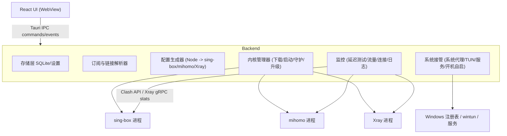
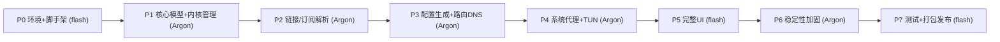

# VPN 客户端开发规划（代号：NovaProxy）

> 参考项目：v2rayN（C#/Avalonia，多内核）、v2rayNG（Android/Kotlin，Xray）、Clash Verge Rev（Tauri+mihomo）、FlClash / Hiddify（Flutter+mihomo/sing-box）。
> 核心思路与它们一致：**不自己实现协议**，而是做一个"多内核管理 + 订阅/配置转换 + 系统接管 + UI"的外壳。协议的正确性与稳定性由成熟内核保证。

---

## 0. 关键技术决策（默认值，可在开工前修改）

| 项目 | 默认选择 | 理由 |
|---|---|---|
| 首发平台 | **Windows 10/11 x64** | 当前开发机为 Windows；架构保留 macOS/Linux 扩展能力 |
| 桌面框架 | **Tauri 2（Rust 后端）+ React 18 + TypeScript + Vite** | 与 Clash Verge Rev 同路线，体积小、内存低、原生能力强 |
| UI 组件 | Tailwind CSS + shadcn/ui，状态管理 Zustand，数据请求 TanStack Query | 生态成熟、模型生成代码质量高 |
| 主内核 | **sing-box**（默认） | 协议覆盖最广、单内核即可支持 TUN |
| 副内核 | **mihomo**（Clash Meta）、**Xray-core** | mihomo 覆盖 SSR/Snell/mieru 及 Clash 订阅原生兼容；Xray 覆盖 XHTTP/mKCP 等独有传输 |
| 内核运行方式 | 独立子进程（sidecar），通过 Clash API / gRPC / 本地端口通信 | 内核崩溃不拖垮 UI；规避 GPL 静态链接问题 |
| TUN 驱动 | wintun（由 sing-box/mihomo 内置使用） | 业界标准 |
| 本地存储 | SQLite（`rusqlite`）存节点/订阅；JSON/TOML 存设置 | 节点量大时检索快 |

> [!IMPORTANT]
> 本机目前只有 Node 24 和 Git，**缺 Rust 工具链**（阶段 0 安装）。Go 不必装——内核直接下载官方 Release 二进制。

---

## 1. 协议支持矩阵与内核路由

客户端根据节点协议**自动选择内核**（用户也可手动强制）。

| 协议 / 特性 | sing-box | mihomo | Xray | 默认内核 |
|---|:-:|:-:|:-:|---|
| Shadowsocks（含 2022 系列、插件 obfs/v2ray-plugin） | ✅ | ✅ | ✅ | sing-box |
| ShadowsocksR | ❌ | ✅ | ❌ | mihomo |
| VMess（TCP/WS/gRPC/HTTP/H2/QUIC） | ✅ | ✅ | ✅ | sing-box |
| VLESS（TLS / Reality / XTLS-Vision） | ✅ | ✅ | ✅ | sing-box |
| VLESS / VMess + XHTTP、mKCP | ❌ | 部分 | ✅ | Xray |
| Trojan | ✅ | ✅ | ✅ | sing-box |
| Hysteria / Hysteria2 | ✅ | ✅ | 视版本 | sing-box |
| TUIC v5 | ✅ | ✅ | ❌ | sing-box |
| WireGuard | ✅ | ✅ | ✅ | sing-box |
| AnyTLS | ✅ | ✅ | ❌ | sing-box |
| ShadowTLS v3 | ✅ | ✅ | ❌ | sing-box |
| NaiveProxy | ✅（需特定构建） | ❌ | ❌ | sing-box |
| Snell / mieru | ❌ | ✅ | ❌ | mihomo |
| SSH | ✅ | ✅ | ❌ | sing-box |
| SOCKS5 / HTTP(S) | ✅ | ✅ | ✅ | sing-box |

> [!NOTE]
> 内核能力随版本变动。阶段 1 需实现 `CoreCapabilities` 表（数据驱动、可热更新），不要把上表硬编码在业务逻辑里。

**支持的导入格式：**
- 分享链接：`ss://` `ssr://` `vmess://`（v2rayN Base64 JSON 格式）`vless://` `trojan://` `hysteria://` `hy2://`/`hysteria2://` `tuic://` `wireguard://`/`wg://` `anytls://` `socks://` `http(s)://` `naive+https://` `ssh://`
- 订阅：Base64 链接列表、纯文本链接列表、**Clash/mihomo YAML**、**sing-box JSON**、SIP008（SS JSON）
- 订阅响应头 `subscription-userinfo`（流量/到期解析）、`profile-update-interval`
- 二维码（屏幕截图识别 + 图片导入）、剪贴板批量导入

---

## 2. 总体架构



**统一中间模型（最关键的设计）：** 所有导入格式 → `ProxyNode`（Rust struct，serde）→ 各内核配置。
解析器与生成器之间只通过 `ProxyNode` 交流，新增协议 = 加一个解析器 + 在各生成器加一个分支。

### 目录结构

```
NovaProxy/
├─ docs/                    PLAN.md（本文件）、PROGRESS.md（进度交接）、ARCHITECTURE.md
├─ src/                     React 前端
│  ├─ pages/                Dashboard, Proxies, Subscriptions, Rules, Connections, Logs, Settings
│  ├─ components/  stores/  lib/ipc.ts  i18n/（zh-CN, en-US）
├─ src-tauri/
│  ├─ src/
│  │  ├─ model/             ProxyNode, Subscription, Settings, RuleSet
│  │  ├─ parser/            每协议一个文件 + clash_yaml.rs + singbox_json.rs + base64.rs
│  │  ├─ generator/         singbox.rs, mihomo.rs, xray.rs, routing.rs, dns.rs
│  │  ├─ core/              manager.rs, process.rs, capabilities.rs, updater.rs
│  │  ├─ system/            sysproxy.rs, tun.rs, service.rs, autostart.rs, elevation.rs
│  │  ├─ monitor/           latency.rs, traffic.rs, connections.rs, logs.rs
│  │  ├─ storage/           db.rs, migrations/
│  │  └─ commands/          Tauri 命令层（薄层，只做参数转换）
│  ├─ resources/cores/      内核二进制（构建时下载，不入库）
│  └─ tests/fixtures/       各协议真实格式链接样本、Clash/sing-box 订阅样本
├─ scripts/                 fetch-cores.ps1, build.ps1
└─ .github/workflows/       CI
```

---

## 3. 分阶段执行计划

模型分工原则：**Gemini-4-Argon** 负责架构设计、协议解析、系统级与稳定性等高难度阶段；**Gemini-3.8-flash** 负责脚手架、UI、打包等工作量大但模式化的阶段。



---

### 阶段 P0：环境与脚手架 — 🤖 Gemini-3.8-flash

**任务**
1. 安装 Rust（rustup，stable-msvc），确认 VS Build Tools C++ 工作负载与 WebView2 存在；安装 pnpm。
2. 在工作区根目录创建 Tauri 2 + React + TS + Vite 项目，配置 Tailwind、shadcn/ui、Zustand、TanStack Query、i18next、ESLint/Prettier、`cargo clippy`/`rustfmt`。
3. 按第 2 节建立完整目录骨架（空模块 + `mod.rs`）。
4. 编写 `scripts/fetch-cores.ps1`：从 GitHub Release 下载最新 sing-box、mihomo、Xray 的 windows-amd64 版本到 `src-tauri/resources/cores/`，记录版本号到 `cores.lock.json`，校验 SHA256（如有）。
5. 配置 Tauri `externalBin`/resources 使内核随应用打包。
6. 初始化 git，`.gitignore` 排除内核二进制与构建产物。
7. 将本 PLAN.md 复制到 `docs/PLAN.md`，创建 `docs/PROGRESS.md`。

**验收标准**
- `pnpm tauri dev` 能打开空白窗口；`cargo clippy` 无错误。
- 运行 fetch 脚本后三个内核 `--version`（xray 为 `version`）均可执行。

---

### 阶段 P1：核心数据模型 + 内核管理器 — 🧠 Gemini-4-Argon

**任务**
1. `model/`：定义 `ProxyNode`（通用字段：id、name、server、port、protocol 枚举、tls 配置、transport 配置、协议特有字段用 enum 承载）、`Subscription`、`Settings`、`RoutingMode`（Rule/Global/Direct）。全部 `serde` 可序列化，并有 TS 类型导出（`ts-rs` 或 `specta`）。
2. `storage/`：SQLite schema + 迁移（节点、订阅、分组、设置、延迟历史）。
3. `core/capabilities.rs`：数据驱动的协议→内核能力表 + 自动选核逻辑。
4. `core/process.rs` / `manager.rs`：
   - 启动/停止/重启内核子进程（Windows 下 `CREATE_NO_WINDOW`，使用 Job Object 保证 UI 退出时内核一并退出）
   - 启动前 `check` 配置（`sing-box check`、`mihomo -t`、`xray -test`）
   - stdout/stderr 采集到环形日志缓冲，通过 Tauri event 推送前端
   - 端口占用检测与自动换端口
   - 进程状态机：`Stopped → Starting → Running → Stopping / Crashed`
5. `core/updater.rs`：检查与下载内核新版本（支持经当前代理下载），失败回滚。
6. 最小 Tauri 命令：`core_start`、`core_stop`、`core_status`、`core_logs`；前端临时调试页能调用。

**验收标准**
- 用手写的 sing-box 最小配置（mixed 入站 + direct 出站）能从 UI 启停，日志实时显示。
- 强杀 UI 进程后内核进程不残留。
- `cargo test` 覆盖状态机与选核逻辑。

---

### 阶段 P2：分享链接与订阅解析 — 🧠 Gemini-4-Argon

**任务**
1. `parser/` 每种协议一个模块，实现 `parse(uri) -> Result<ProxyNode>` 与 `to_uri(&ProxyNode) -> String`（导出/分享用）。严格参照 v2rayN 与 v2rayNG 的链接格式实现（尤其 vmess 的 Base64 JSON 字段、vless/trojan 的 query 参数：`type security sni alpn fp pbk sid spx flow path host serviceName mode headerType`）。
2. 订阅解析：自动识别格式（Base64 / 纯文本 / Clash YAML / sing-box JSON / SIP008），容错处理（URL-safe Base64、缺 padding、BOM、CRLF、非法行跳过并记录）。
3. 订阅下载：自定义 UA（如 `clash.meta`、`v2rayN/x.y` 可选，影响服务端返回格式）、超时、重试、可选经代理更新、解析 `subscription-userinfo`。
4. 订阅更新策略：按节点指纹（server+port+protocol+关键凭据）去重与增量更新，保留用户自定义名称/排序。
5. 剪贴板批量导入、二维码识别（`rqrr` 或 `quircs` 解码图片，截屏用 `xcap`）。
6. `tests/fixtures/` 每协议至少 5 个样本（含边界情况：IPv6、中文/emoji 名称、URL 编码、缺可选字段），往返测试 `parse → to_uri → parse` 一致。

**验收标准**
- 所有 fixture 测试通过；不支持的协议返回明确错误而非 panic。
- 能导入一个真实的 Clash YAML 订阅和一个 Base64 订阅。

---

### 阶段 P3：配置生成器、路由与 DNS — 🧠 Gemini-4-Argon

**任务**
1. `generator/singbox.rs`、`mihomo.rs`、`xray.rs`：`ProxyNode` 列表 + 设置 → 完整内核配置。每个协议/传输/TLS/Reality 组合都要覆盖。
2. 入站：mixed（HTTP+SOCKS 同端口，默认 `127.0.0.1:7890`），可选局域网共享、认证；TUN 入站（P4 启用）。
3. 出站组：手动选择（selector）、自动测速（urltest）、故障转移（fallback）、负载均衡。
4. 路由：
   - 模式：规则 / 全局 / 直连
   - 预置规则集：中国大陆直连（geosite:cn、geoip:cn）、广告拦截、私有地址直连；使用 sing-box `rule_set`（.srs）与 mihomo rule-providers，自动更新
   - 用户自定义规则（域名/IP/进程名/端口），图形化编辑的数据模型
5. DNS：分流 DNS（国内域名走国内 DoH，其余走远程 DoH）、FakeIP 可选、防 DNS 泄露。
6. 多内核并存：当用户在 sing-box 中选中仅 Xray 支持的节点时，策略为「Xray 作为上游 SOCKS，sing-box 作为前置负责路由与 TUN」（v2rayN 的前置/链式代理思路）。
7. 链式代理（前置代理/落地节点）。
8. 快照测试：每种协议的生成结果与 golden 文件对比，并对生成配置执行内核 `check` 命令验证。

**验收标准**
- 对每个协议 fixture 生成的配置都能通过对应内核的 check。
- 使用一个真实节点能通过 `127.0.0.1:7890` 访问外网（手动设置浏览器代理）。

---

### 阶段 P4：系统代理与 TUN 模式 — 🧠 Gemini-4-Argon

**任务**
1. `system/sysproxy.rs`：通过 WinINet `InternetSetOptionW` 设置/恢复系统代理（含 PAC 模式、绕过列表），而非只写注册表；启动时记录原始设置，退出/崩溃时恢复。
2. TUN 模式：
   - 需要管理员权限：方案 A 以管理员重启自身；方案 B（推荐，参考 Clash Verge Rev）安装一个轻量 Windows 服务（`windows-service` crate），由服务以 SYSTEM 拉起内核，UI 通过命名管道与服务通信。
   - `auto_route`、`strict_route`、排除本应用/内核进程防回环、MTU、IPv6 开关。
3. 开机自启（注册表 Run 或任务计划，TUN 模式下用服务）。
4. 系统托盘：切换模式、切换节点、开关系统代理/TUN、退出。
5. 单实例锁（`tauri-plugin-single-instance`）、URL Scheme 注册（`novaproxy://install-config?url=` 与 `clash://install-config?url=` 一键导入订阅）。

**验收标准**
- 系统代理开关后浏览器即时生效，异常退出后再次启动能恢复干净状态。
- TUN 模式下非代理感知程序（如 `curl` 不带代理参数、游戏客户端）流量可走代理；关闭后网络正常、无残留路由。

---

### 阶段 P5：完整 UI — 🤖 Gemini-3.8-flash

**页面**
- **仪表盘**：连接状态大开关、当前节点、模式切换、实时上下行速度曲线、今日流量。
- **节点**：按订阅/分组展示，搜索、排序（延迟/名称）、批量测速（TCP ping 与真实 URL 测试两种）、多选删除/导出/分享二维码、手动添加/编辑节点表单（按协议动态字段）。
- **订阅**：增删改、手动/自动更新间隔、流量与到期显示、UA 选择。
- **规则**：模式选择、规则集开关、自定义规则编辑器（拖拽排序）。
- **连接**：实时连接列表（来自 Clash API `/connections`），可关闭单个连接。
- **日志**：级别过滤、搜索、暂停、导出。
- **设置**：端口、局域网共享、DNS、TUN 参数、内核选择与升级、开机自启、语言、主题（亮/暗/跟随系统）、备份与恢复（导出全部配置为 zip）。

**要求**：中英双语；所有后端调用经 `lib/ipc.ts` 统一封装并使用生成的 TS 类型；长操作有 loading 与错误 toast；列表虚拟滚动（上千节点不卡）。

**验收标准**：所有页面功能联通后端，无 TS 错误，1000 节点列表滚动流畅。

---

### 阶段 P6：稳定性加固 — 🧠 Gemini-4-Argon

**任务**
1. **内核守护**：崩溃自动重启（指数退避，N 次失败后停止并通知），记录崩溃日志。
2. **健康检查**：定时探测（如 `https://www.gstatic.com/generate_204`），当前节点连续失败时按策略自动切换到可用节点。
3. **网络环境变化**：监听网络切换（`NotifyIpInterfaceChange`）、休眠唤醒（`WM_POWERBROADCAST`），触发连接重置/内核重载。
4. **热重载**：切换节点/规则优先使用内核 API（Clash API `PUT /proxies/{group}`）而非重启进程，避免断流。
5. **配置安全**：写配置采用临时文件 + 原子替换；数据库定期备份；损坏时自动从备份恢复。
6. **资源与泄漏**：长时间运行（24h）内存与句柄稳定；日志文件轮转。
7. **错误上报**：本地诊断包一键导出（脱敏后的配置、日志、系统信息）。
8. 全面审查 `unwrap()`/`expect()`，替换为可恢复错误；前端加全局 ErrorBoundary。

**验收标准**
- 手动 kill 内核进程 → 自动恢复；拔网线/切 Wi-Fi/休眠唤醒 → 自动恢复连通。
- 24 小时挂机测试内存增长 < 20%。

---

### 阶段 P7：测试、打包与发布 — 🤖 Gemini-3.8-flash

**任务**
1. 补齐单元测试与集成测试（Rust `cargo test`，前端 Vitest），关键路径 E2E（Playwright 或 WebDriver for Tauri）。
2. GitHub Actions：lint → test → 下载内核 → 构建 NSIS 安装包 + 便携版 zip。
3. 应用自动更新（`tauri-plugin-updater`，签名密钥）。
4. 编写 README（中英）、用户手册、常见问题、第三方许可证清单（sing-box GPL-3.0、mihomo GPL-3.0、Xray MPL-2.0 等）。
5. 发布 v0.1.0。

**验收标准**：CI 全绿；全新 Windows 虚拟机上安装→导入订阅→连接→卸载 全流程无问题。

---

### 后续可选阶段（P8+）
- macOS / Linux 适配（sysproxy 与 TUN 平台实现已按 trait 抽象，补实现即可）
- Android 版（Tauri 2 mobile 或独立 Kotlin 项目，参考 v2rayNG 的 `VpnService` + libbox）

---

## 4. 给执行模型的通用规则（每个阶段都必须遵守）

1. **开工前**先读 `docs/PLAN.md` 与 `docs/PROGRESS.md`，确认上一阶段已完成且验收通过。
2. **只做当前阶段的任务**，不要提前实现后续阶段内容（可留 `TODO(Pn)` 注释）。
3. 不自行实现任何加密/代理协议，一律交给内核。
4. 每完成一个子任务就在 `docs/PROGRESS.md` 勾选并写简要说明；遇到偏离计划的设计变更，在 PROGRESS.md 的「决策记录」中写明原因。
5. 阶段结束前必须运行：`cargo fmt --check`、`cargo clippy -- -D warnings`、`cargo test`、`pnpm lint`、`pnpm tsc --noEmit`，全部通过后再 git commit（信息格式：`feat(P2): ...`）。
6. 不在代码或 fixture 中写入任何真实可用的节点凭据。
7. **阶段完成后立即停止**，向用户输出：
   - 本阶段完成内容与验收结果
   - 已知问题 / 遗留 TODO
   - 明确提示：「✅ 阶段 Pn 已完成，请切换到 **〈下一阶段指定的模型〉** 并发送『继续执行阶段 Pn+1』」

### PROGRESS.md 模板

```markdown
# 进度
当前阶段：P0
## P0 环境与脚手架（flash）
- [ ] 安装 Rust ...
## 决策记录
- YYYY-MM-DD Pn：...（原因）
## 已知问题
```

---

## 5. 主要风险

| 风险 | 应对 |
|---|---|
| 各内核配置格式随版本变化（尤其 sing-box 1.x 有破坏性变更） | `cores.lock.json` 锁定版本；生成器按内核版本分支；升级前跑 check 测试 |
| TUN 模式权限与回环问题 | 采用服务方案 + 进程排除；P4 重点测试 |
| 杀毒软件误报 | 代码签名证书；内核来自官方 Release 并校验哈希 |
| GPL 许可证 | 内核作为独立进程分发并附源码链接与许可证；若需闭源外壳需法律确认 |
| 订阅格式五花八门 | fixture 驱动开发，持续收集样本 |
